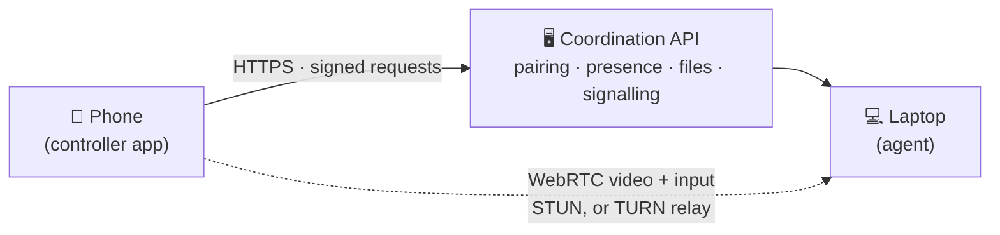

# 🌉 ABHIVERSE

[](https://github.com/MSAbhishek22/AbhiVerse/actions)
[](LICENSE)
[](https://github.com/MSAbhishek22/AbhiVerse/releases)
[](https://msabhishek22.github.io/AbhiVerse/)

**Your phone is the remote for your laptop. From anywhere. No account. No subscription. No trackers.**

> **Status: v0.5.4 — beta pre-release.** Rust 51/51 tests, Flutter 42 tests + 1 skipped, CI green
> (Rust, Windows target, Flutter, Android). The one honest gap: the first real-device run — WebRTC
> media, screen capture, and input on physical hardware — is still the release blocker.
> See [`docs/real-device-test.md`](docs/real-device-test.md) and
> [`docs/known-limitations.md`](docs/known-limitations.md). Everything below marked ✅ runs;
> anything else is labelled, not hidden.

## 💡 Why does this exist? A story you already know

You are in the market. Your laptop is at home. You need a file from it — or you need to check
something on its screen, or start something on it before you get back.

Right now your options are:

- **Apple Continuity / Phone Link** — beautiful, but only if you live entirely inside one
  company's garden. Apple-to-Apple. Microsoft account to Windows. Your devices, their rules.
- **AnyDesk / TeamViewer** — powerful, closed-source, subscription-priced, account-gated.
  You are the product's guest, not its owner.
- **LocalSend / plain file sharing** — free and simple, but only on the same Wi-Fi. Step out
  of the house and the magic stops.
- **Nothing** — for the combination: *my* phone, *my* laptop, *any* network, *no* account,
  *my* server if I want one.

**Nothing new. Something missing.** Every piece of Abhiverse existed before — pairing codes,
signed requests, WebRTC video, chunked file transfer. What was missing was all of it in one
place, open-source, working from the market as well as from the living room, without handing
your devices to someone else's account system. So it got built.



One rule makes the whole thing work: **both sides talk to the same API URL.** Same Wi-Fi,
different cities, phone on mobile data — it does not matter, as long as both sides can reach
that one URL. See [`docs/remote-access.md`](docs/remote-access.md) for the VPS path and the
free Cloudflare Tunnel path.

## ✨ What you can do today

| From your phone | How it works | Status |
|---|---|---|
| See your laptop online | Heartbeat every 10 s, 30 s online window | ✅ |
| Pair in seconds | 6-digit code or QR scan, approved on the laptop itself | ✅ |
| Send / receive files | 256 KiB chunks, SHA-256 verified, resumable, 1 GiB cap | ✅ |
| Watch the laptop screen | WebRTC + H.264 (DXGI capture), adaptive quality tiers | ✅ code, ⏳ first real-device run |
| Move the mouse, type | `SendInput` injection, behind an explicit agent flag | ✅ code, ⏳ first real-device run |
| Revoke instantly | Signed revoke from either side, kills live sessions too | ✅ |
| Change server, read the docs | In-app Settings hub: Terms, Privacy & Security, FAQ, licences, Support, About | ✅ |

## 🙅 What it is NOT (yet)

- Not notifications/calls mirroring — this is a **control centre** (presence, files, remote
  desktop), not a Phone Link clone feature-for-feature.
- Not a Play Store app yet — the Android build is a debug-signed APK from CI (sideload only).
- Not verified on real hardware yet — media, capture, and input await the real-device run.
- Not power controls, clipboard sync, multi-monitor, or audio yet — deliberately not rushed.
  The full honest list lives in [`docs/known-limitations.md`](docs/known-limitations.md).

## 🚀 Get started

### 1. The coordination API

```sh
cargo run -p abhiverse-api
# listening on http://127.0.0.1:8080
curl http://127.0.0.1:8080/health
```

For anywhere-access, deploy it (see [`docs/remote-access.md`](docs/remote-access.md)):
**VPS path** — Caddy auto-HTTPS → API + coturn (the only path with a TURN fallback), or
**Tunnel path** — free, no VPS, `cloudflared tunnel --url http://localhost:8080`
(STUN-only media; the URL changes per restart, so re-point both sides).

### 2. The laptop agent

```sh
cargo run -p abhiverse-agent-windows -- --pair --api <your-api-url>
# scan the QR (or enter the 6-digit code) in the app, approve with y on the laptop
cargo run -p abhiverse-agent-windows                # presence heartbeat, until Ctrl+C
cargo run -p abhiverse-agent-windows -- --remote    # answer remote sessions (asks first)
cargo run -p abhiverse-agent-windows -- --remote --trust-paired
#   unattended mode: sessions from your paired phone auto-accept.
#   Anyone else is rejected. Never implies --allow-input.
cargo run -p abhiverse-agent-windows -- --receive   # download files sent to this computer
cargo run -p abhiverse-agent-windows -- --revoke    # unpair this device, instantly
```

On first run the agent creates an Ed25519 key pair (`ABHIVERSE_DATA_DIR`, default
`~/.abhiverse/agent`). The device ID is the fingerprint of the public key.
**Guard `keypair.json` like a password — it *is* the device's identity.**

**Laptop on = agent on.** No more "did I open the app?" before leaving the house:

```powershell
.\scripts\install-autostart.ps1                    # presence at every logon
.\scripts\install-autostart.ps1 -Remote -TrustPaired  # unattended remote, your phone only
.\scripts\uninstall-autostart.ps1                  # remove it again, completely
```

Autostart is a visible Startup-folder shortcut for the current user — no admin, no service
(a service cannot touch the interactive desktop), no registry tricks, and the agent binary
never installs persistence by itself. Full rationale + loophole audit:
[`docs/autostart.md`](docs/autostart.md).

### 3. The phone app

```sh
cd apps/controller
flutter pub get
flutter run
```

Point it at your API from **Settings → Server** inside the app (no rebuild needed).
Public HTTP is refused, LAN HTTP warns — HTTPS anywhere is the happy path.
Or grab the latest CI APK from
[Actions → `abhiverse-controller-apk`](https://github.com/MSAbhishek22/AbhiVerse/actions)
(debug-signed: your phone will warn about an unknown developer. That warning is correct.)

## 🔐 Security in 60 seconds

- **Keys, not passwords.** Every device and every controller has its own Ed25519 identity.
  Requests are signed; the server verifies. A stolen session id alone buys nothing.
- **Approval lives on the target.** Pairing needs a `y` on the laptop. Remote sessions need
  a `y` on the laptop — unless you deliberately chose `--trust-paired`, which trusts only
  the already-paired controller and nobody else.
- **Revoke is instant and total.** From either side, including live remote sessions.
- **No trackers. No account. No subscription.** Keys never leave devices. The app asks for
  exactly two permissions: camera (QR scan) and internet.
- **The blunt part (also in the app's Terms):** approving the wrong device, exposing a
  server without HTTPS, or ignoring the cleartext warning is *your* fault. Bugs in
  Abhiverse's own code are *ours*. Read the full model in [`SECURITY.md`](SECURITY.md)
  and [`docs/threat-model.md`](docs/threat-model.md).

## 🧪 Tests & checks

```sh
cargo fmt --all --check
cargo clippy --workspace --all-targets -- -D warnings
cargo test --workspace
cd apps/controller && flutter analyze && flutter test
```

Current: Rust 51/51, Flutter 42 + 1 skipped, clippy/fmt/analyze clean, CI green.
The dev sandbox blocks all UDP, so WebRTC media can only be verified on real hardware —
that is the release blocker, not a footnote.

## 🗂️ Repository layout

```
abhiverse/
├── apps/controller/     # Flutter controller (Android first)
├── agents/windows/      # Rust device agent
├── crates/protocol/     # Shared protocol types (protocol v2)
├── crates/identity/     # Ed25519 device identity
├── crates/file-transfer/# Chunked, SHA-256-verified transfer
├── crates/win-input/    # DXGI capture + SendInput injection
├── server/api/          # Rust coordination API (Axum)
├── scripts/             # Real-device runner, autostart installer
├── docs/                # Architecture, protocol, threat model, guides
└── .github/workflows/   # CI: Rust + Windows target + Flutter + Android
```

## 🗺️ Roadmap

- **Now:** real-device run (the release blocker) → hosted staging → installable beta
- **Later:** power controls, clipboard sync, multi-monitor, audio, LAN auto-discovery,
  multi-device dashboard — in that order, only when each is done properly

## 🤝 Contributing & support

Read [`docs/architecture.md`](docs/architecture.md) and
[`docs/threat-model.md`](docs/threat-model.md) before touching anything security-sensitive.
Issues and PRs are welcome — this is MIT-licensed open source, built by
**M S Abhishek**, with love. The app itself stays free forever; if it helps you and you
want to support it, the Support section (in the app and on the
[website](https://msabhishek22.github.io/AbhiVerse/)) has the details.

## 📄 License

MIT — see [`LICENSE`](LICENSE).
